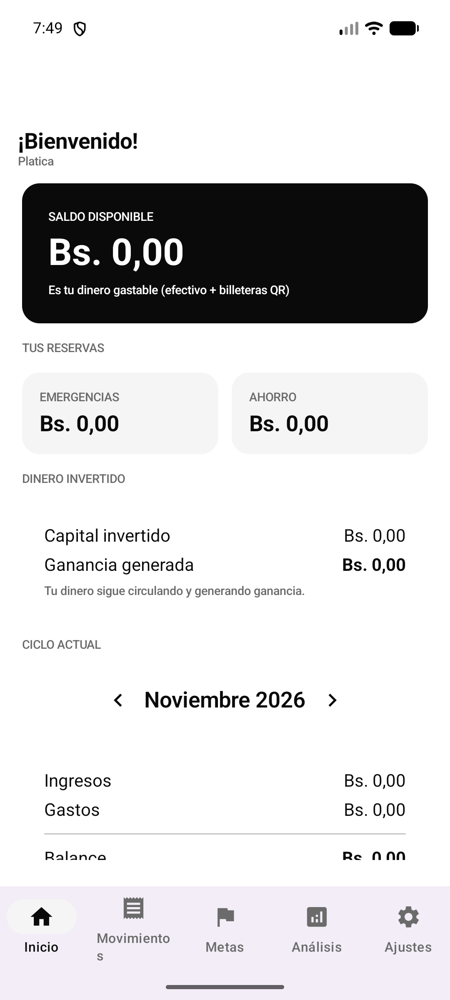
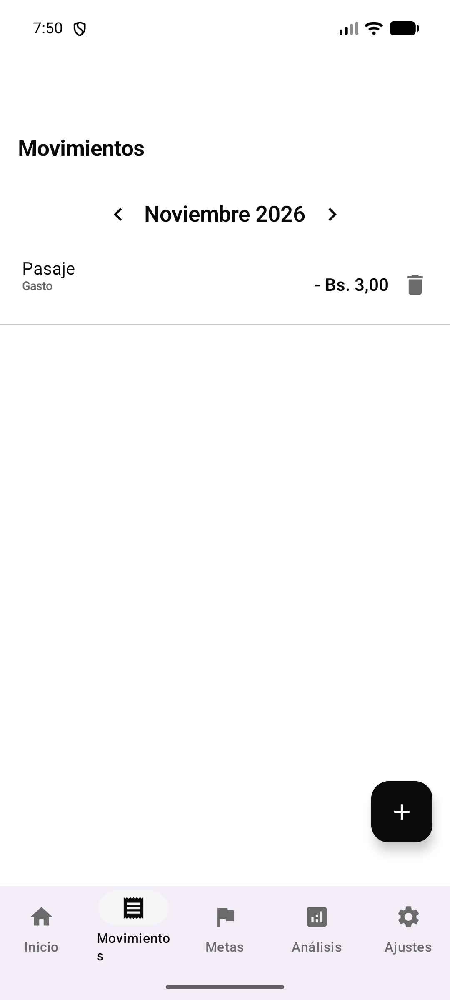
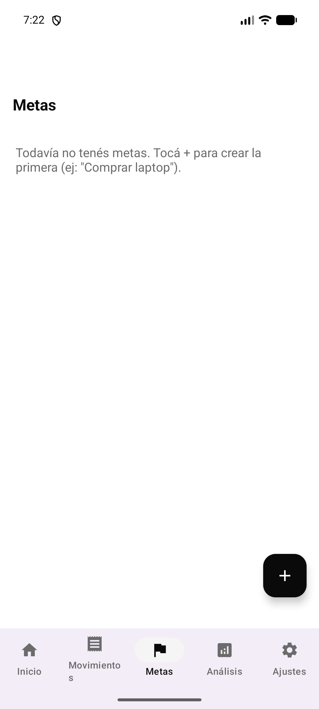
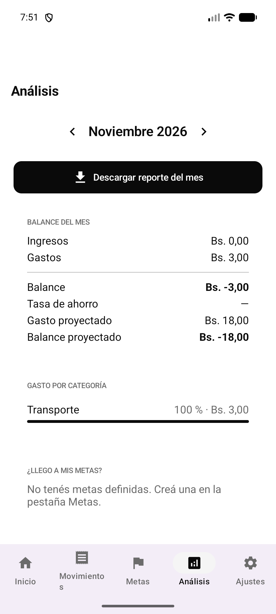
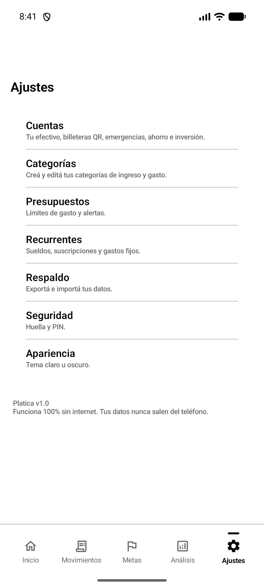
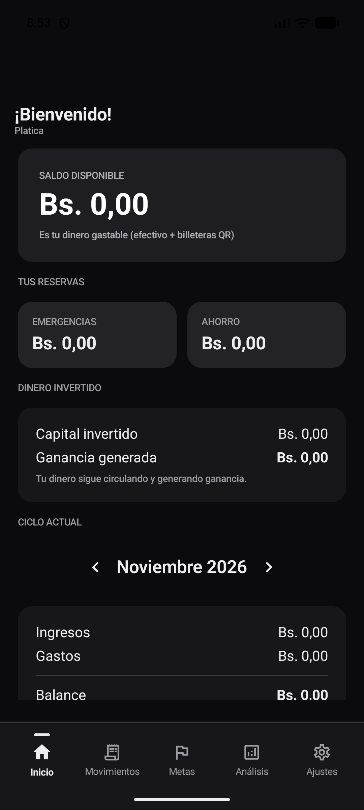

# Platica

Aplicación Android nativa para el control de gastos personales, las metas de ahorro y la organización del dinero del día a día. Funciona **100 % offline**, guarda los datos **cifrados en el dispositivo** y no declara el permiso `INTERNET`.

Desarrollada en Kotlin con Jetpack Compose, Room + SQLCipher y Hilt. Interfaz minimalista en blanco y negro, en español de Bolivia y con montos en bolivianos (Bs.).


---

## Índice

1. [Descripción general](#descripción-general)
2. [Funcionalidades](#funcionalidades)
3. [Capturas](#capturas)
4. [Arquitectura](#arquitectura)
5. [Tecnologías](#tecnologías)
6. [Estructura del repositorio](#estructura-del-repositorio)
7. [Base de datos y migraciones](#base-de-datos-y-migraciones)
8. [Compilación](#compilación)
9. [Firma del APK](#firma-del-apk)
10. [Instalación y actualización](#instalación-y-actualización)
11. [Privacidad y modo offline](#privacidad-y-modo-offline)
12. [Respaldos](#respaldos)
13. [Documentación](#documentación)
14. [Historial de versiones](#historial-de-versiones)
15. [Autor](#autor)

---

## Descripción general

Platica resuelve un problema concreto: saber cuánto dinero se tiene realmente y cuánto se puede gastar sin comprometer el ahorro. El saldo disponible se calcula en vivo a partir de las cuentas de efectivo y billeteras QR, mientras que el ahorro, las emergencias y las inversiones se muestran como reservas separadas.

El proyecto nació para estudiantes bolivianos con ingresos variables, pero sirve para cualquier persona que quiera llevar sus finanzas sin depender de la nube ni de una conexión permanente.

### Principios de diseño

- **Offline por diseño:** no existe capa de red, ni API, ni sincronización remota.
- **Privacidad primero:** la base de datos local está cifrada con AES-256 mediante SQLCipher.
- **Datos del usuario, en el teléfono:** la aplicación no recopila ni envía información.
- **Simplicidad:** registrar un movimiento debe tomar segundos.
- **Legibilidad:** interfaz monocromática, jerarquía clara y modo oscuro completo.

---

## Funcionalidades

### Inicio

- Saldo disponible calculado en tiempo real.
- Reservas separadas de emergencias y ahorro.
- Capital invertido y ganancia generada.
- Resumen del ciclo actual: ingresos, gastos y balance.
- Movimientos recientes y aviso de metas alcanzables.

### Movimientos

- Registro de ingresos y gastos.
- Clasificación por categoría y cuenta de origen.
- Movimientos irregulares y recurrentes.
- Edición y eliminación.
- Filtro por mes y búsqueda.
- Plantillas de gasto rápido.

### Metas de ahorro

- Creación y edición de metas con nombre, detalle y costo.
- Progreso calculado con el saldo real de la cuenta de ahorro.
- **Prioridad Alta, Media o Baja** para ordenar las metas y destacar lo más importante.
- Orden automático: estado, prioridad y fecha de creación.
- Indicación de cuánto falta y cuánto hay que ahorrar para alcanzar la meta.
- Detección de metas que ya se pueden comprar con el saldo actual.

### Análisis

- Ingresos, gastos y balance por mes.
- Tasa de ahorro.
- Gasto proyectado a fin de mes.
- Distribución de gastos por categoría.
- Proyección de cumplimiento de metas.
- Comparativa de movimientos por cuenta.

### Cuentas

- Efectivo, billetera QR, emergencias, ahorro e inversión.
- Saldo inicial, edición y eliminación.
- Detalle de movimientos por cuenta.
- Cálculo de saldos sin almacenar valores duplicados.

### Presupuestos, categorías y recurrentes

- Presupuestos por categoría con límite mensual.
- Categorías de ingreso y gasto editables.
- Movimientos recurrentes con frecuencia configurable.

### Seguridad y respaldo

- Bloqueo con PIN, huella digital o ambos.
- Base de datos cifrada con SQLCipher.
- Exportación e importación de respaldo completo en JSON.
- Respaldo del historial de aportes a metas.
- Compatibilidad con respaldos de versiones anteriores.

### Apariencia

- Tema claro, oscuro o según el sistema.
- Paleta monocromática y tipografía consistente.

---

## Capturas

| Inicio | Movimientos | Metas |
|---|---|---|
|  |  |  |

| Análisis | Ajustes | Tema oscuro |
|---|---|---|
|  |  |  |

Las capturas adicionales están disponibles en la carpeta [`capturas/`](capturas/).

---

## Arquitectura

Platica aplica una arquitectura en capas, deliberadamente simple, con flujo unidireccional de datos.

```text
UI (Jetpack Compose + ViewModels)
        |
        v
Dominio (repositorios, calculadoras, reglas de negocio)
        |
        v
Datos (Room + SQLCipher, DataStore, respaldos JSON)
```

### Decisiones principales

- **MVVM con StateFlow:** las pantallas observan un único estado inmutable.
- **Repositorios como frontera:** la UI no conoce DAOs ni entidades de persistencia.
- **Cálculos en el dominio:** saldos, progreso de metas y proyecciones son funciones puras y verificables.
- **Sin estado duplicado:** los saldos se derivan de cuentas y movimientos; no se guardan como totales.
- **Migraciones explícitas:** cada cambio de esquema tiene su `Migration` versionada y su esquema JSON.

---

## Tecnologías

| Área | Tecnología |
|---|---|
| Lenguaje | Kotlin 2.0.21 |
| UI | Jetpack Compose, Material 3 |
| Navegación | Navigation Compose |
| Arquitectura | MVVM, StateFlow, corrutinas |
| Persistencia | Room 2.6.1 |
| Cifrado | SQLCipher 4.5.4 (AES-256) |
| Preferencias | DataStore Preferences |
| Inyección de dependencias | Hilt 2.52 |
| Serialización | kotlinx.serialization JSON |
| Seguridad | Android Keystore, BiometricPrompt |
| Build | Gradle 8.14, AGP 8.7.3, JDK 17 |
| Min SDK | 26 (Android 8.0) |
| Target SDK | 35 (Android 15) |

No se utilizan bibliotecas de red: no hay Retrofit, OkHttp, Firebase, Volley ni Ktor.

---

## Estructura del repositorio

```text
Control de Gastos/
├─ Platica/                     Proyecto Android
│  ├─ app/
│  │  ├─ src/main/java/com/bolivia/platica/
│  │  │  ├─ data/               Room, DAOs, repositorios, respaldos
│  │  │  ├─ domain/             Modelos, contratos y casos de uso
│  │  │  ├─ ui/                 Pantallas, componentes, navegación y tema
│  │  │  ├─ di/                 Módulos de Hilt
│  │  │  ├─ security/           PIN y biometría
│  │  │  └─ MainActivity.kt
│  │  ├─ schemas/               Esquemas JSON de Room (v1 a v4)
│  │  └─ build.gradle.kts
│  ├─ gradle/                   Wrapper y catálogo de versiones
│  ├─ keystore.properties       Credenciales locales (ignorado por Git)
│  └─ local.properties          Ruta del SDK (ignorado por Git)
├─ docs/                        Documentación técnica del proyecto
├─ capturas/                    Capturas de pantalla
├─ tools/                       Script de generación de documentación
├─ .gitignore
└─ README.md
```

Los APK, los keystores, `local.properties` y las credenciales de firma no se versionan.

---

## Base de datos y migraciones

La base de datos local se llama `platica.db` y está cifrada con una clave generada y protegida por Android Keystore. El esquema actual es la **versión 4**.

| Versión | Cambios |
|---|---|
| 1 | Esquema inicial: cuentas, categorías, movimientos, metas y aportes. |
| 2 | Detalle de metas, tabla de rendimientos de inversión y nuevos tipos de cuenta. |
| 3 | Presupuestos, plantillas rápidas y movimientos recurrentes. |
| 4 | Prioridad de metas (`ALTA`, `MEDIA`, `BAJA`), con valor por defecto `MEDIA`. |

Las migraciones se encuentran en `Platica/app/src/main/java/com/bolivia/platica/data/local/Migrations.kt` y los esquemas exportados en `Platica/app/schemas/`.

La prioridad no modifica el cálculo del progreso. Solo define el orden de la lista y el destacado visual.

---

## Compilación

### Requisitos

- JDK 17
- Android Studio (recomendado) o Android SDK con las plataformas 35 y las build-tools correspondientes
- Windows, macOS o Linux

### Configuración local

1. Clonar el repositorio.
2. Crear `Platica/local.properties` con la ruta del SDK:

```properties
sdk.dir=C\:\\ruta\\a\\Android\\Sdk
```

3. Verificar que `JAVA_HOME` apunte a un JDK 17.

### Compilar la versión de desarrollo

```bash
cd Platica
./gradlew :app:assembleDebug
```

En Windows:

```powershell
cd Platica
.\gradlew.bat :app:assembleDebug
```

El APK se genera en `Platica/app/build/outputs/apk/debug/`.

### Compilar la versión de release

```powershell
$env:JAVA_HOME = "C:\Program Files\Android\Android Studio\jbr"
$env:ANDROID_HOME = "$env:LOCALAPPDATA\Android\Sdk"
.\gradlew.bat :app:assembleRelease --console=plain
```

El APK firmado se genera en `Platica/app/build/outputs/apk/release/`.

### Verificar un APK

```powershell
& "$env:LOCALAPPDATA\Android\Sdk\build-tools\36.1.0\aapt2.exe" dump badging app-release.apk
& "$env:LOCALAPPDATA\Android\Sdk\build-tools\36.1.0\apksigner.bat" verify --print-certs app-release.apk
```

---

## Firma del APK

Las credenciales de firma no se guardan en el repositorio. El build las lee, en este orden:

1. `Platica/keystore.properties`
2. Variables de entorno

```properties
storeFile=firma/platica-release.jks
storePassword=********
keyAlias=platica
keyPassword=********
```

Variables equivalentes:

```text
PLATICA_STORE_FILE
PLATICA_STORE_PASSWORD
PLATICA_KEY_ALIAS
PLATICA_KEY_PASSWORD
```

Si no hay credenciales configuradas, Gradle genera un release sin firmar. Para publicar o actualizar una instalación existente, usar siempre el mismo keystore.

---

## Instalación y actualización

### Instalar por primera vez

1. Copiar el APK al teléfono.
2. Abrirlo desde Archivos o Descargas.
3. Permitir la instalación de aplicaciones desconocidas para el explorador de archivos.
4. Confirmar la instalación.

### Actualizar conservando los datos

1. Exportar un respaldo desde **Ajustes > Respaldo > Exportar**.
2. Instalar el APK nuevo **encima** del anterior, sin desinstalar.
3. Abrir la aplicación. La migración de la base de datos se ejecuta automáticamente.
4. Verificar la versión en **Ajustes**, al pie de la pantalla.

Si Android muestra "Aplicación no instalada", la versión anterior fue firmada con otra clave. En ese caso: exportar el respaldo, desinstalar, instalar la versión nueva e importar el respaldo.

---

## Privacidad y modo offline

- El manifiesto declara explícitamente la remoción de `android.permission.INTERNET` y `ACCESS_NETWORK_STATE`.
- No hay dependencias de red en `build.gradle.kts`.
- Los datos se almacenan en una base Room cifrada con SQLCipher.
- La clave de cifrado se protege con Android Keystore.
- El respaldo se genera localmente como archivo JSON.
- La aplicación no incluye analítica, publicidad ni servicios de terceros.

Para verificar que el APK no solicita acceso a internet:

```powershell
& "$env:LOCALAPPDATA\Android\Sdk\build-tools\36.1.0\aapt2.exe" dump badging app-release.apk | Select-String "uses-permission"
```

No debe aparecer `android.permission.INTERNET`.

---

## Respaldos

El respaldo incluye:

- Cuentas
- Categorías
- Movimientos
- Metas y su prioridad
- Historial de aportes a metas
- Presupuestos
- Rendimientos de inversión
- Plantillas de gasto rápido

El formato es JSON con versión de esquema. Los respaldos anteriores a la versión 1.2.0 se importan con prioridad `MEDIA` por defecto.

---

## Documentación

La carpeta [`docs/`](docs/) contiene la documentación técnica del proyecto:

- [Visión y alcance](docs/01_vision_y_alcance.md)
- [Requisitos](docs/02_requisitos.md)
- [Arquitectura](docs/03_arquitectura.md)
- [Modelo de datos](docs/04_modelo_de_datos.md)
- [Lógica de negocio](docs/05_logica_de_negocio.md)
- [Flujo de UI/UX](docs/06_flujo_ui_ux.md)
- [Seguridad y respaldo](docs/07_seguridad_y_respaldo.md)
- [Tecnología](docs/08_tecnologia.md)
- [Calidad y pruebas](docs/09_calidad_y_pruebas.md)
- [Plan de proyecto](docs/10_plan_de_proyecto.md)
- [Glosario](docs/11_glosario.md)
- [Trazabilidad](docs/12_trazabilidad.md)

También se incluye `Platica_Documentacion.docx`, generado con `tools/generar_word.py`.

---

## Historial de versiones

| Versión | Código | Cambios |
|---|---|---|
| 1.2.0 | 3 | Prioridad de metas, edición de metas, migración de base de datos a v4 y respaldo del historial de aportes. |
| 1.1.0 | 2 | Presupuestos, categorías editables, recurrentes, inversiones y mejoras de seguridad. |
| 1.0.0 | 1 | Versión inicial: cuentas, movimientos, metas, análisis, respaldo y bloqueo. |

---

## Autor

Proyecto personal de **Josué** ([@josue1239O](https://github.com/josue1239O)).

Bolivia, 2026.
